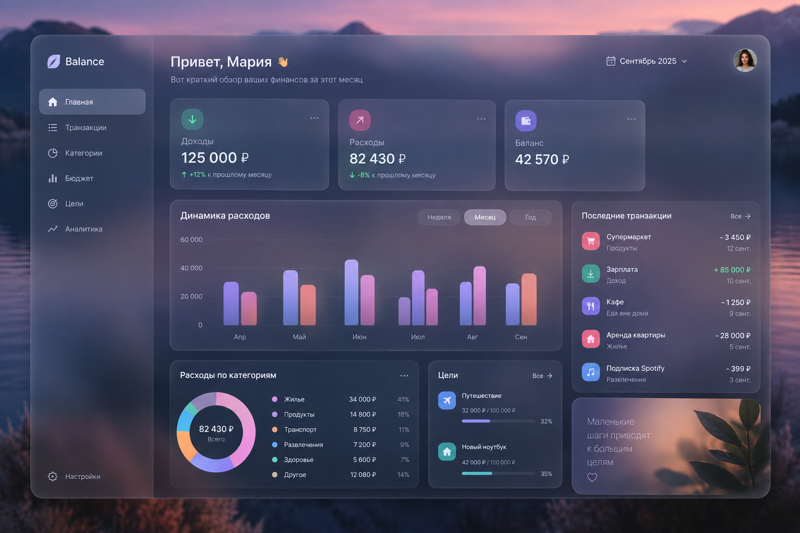

# Balance

**Balance** — финансовый трекер для учета доходов и расходов, планирования бюджета и анализа личных финансов. Цель проекта — собрать повседневный учет и понятную аналитику в одном спокойном, наглядном интерфейсе.

> Изображение ниже — концепт будущего дашборда. Это макет запланированного интерфейса, а не снимок уже реализованных функций.

## Что планируется

- **Учет операций:** доходы и расходы с суммой, датой, счетом, категорией и комментарием.
- **Счета:** отдельный учет банковских счетов, наличных и других источников средств.
- **Категории:** организация операций по категориям и вложенным подкатегориям.
- **Главный экран:** баланс, доходы и расходы за выбранный период, последние операции.
- **Аналитика:** динамика финансов, структура расходов по категориям и сравнение периодов.
- **Бюджеты и цели:** планирование лимитов и накоплений с отображением прогресса.

## Текущий статус

В проекте уже есть регистрация и вход в аккаунт, обновление сессии, а также просмотр, создание и редактирование категорий с вложенными подкатегориями.

Разделы счетов, операций, главного дашборда и аналитики пока являются заглушками. Возможности с макета — графики, бюджеты, цели и сводные карточки — входят в план развития и ещё не реализованы.

## Технологии

- **Frontend:** React, TypeScript, Vite, React Router, TanStack Query, Zustand.
- **Backend:** NestJS, TypeScript, TypeORM.
- **База данных:** PostgreSQL.
- **Запуск окружения:** Docker Compose.

## Запуск локально

Нужны Docker и Docker Compose.

1. Создайте файл .env из шаблона .env.example:

   ~~~powershell
   Copy-Item .env.example .env
   ~~~

   Если .env уже существует, не перезаписывайте его.
   В .env задайте POSTGRES_DB, POSTGRES_USER, POSTGRES_PASSWORD и JWT_SECRET. Остальные параметры можно оставить по умолчанию.

2. Укажите адрес API для Vite в frontend/.env.local:

   ~~~dotenv
   VITE_API_URL=http://localhost:3000
   ~~~

3. Запустите PostgreSQL и примените миграции:

   ~~~powershell
   docker compose up -d postgres
   docker compose run --rm backend npm run migration:run
   ~~~

   Перед запуском миграций дождитесь, пока PostgreSQL полностью запустится.

4. Запустите frontend и backend:

   ~~~powershell
   docker compose up --build
   ~~~

Приложение будет доступно по адресу [http://localhost:5173](http://localhost:5173), API — по адресу [http://localhost:3000](http://localhost:3000).

## Проверка frontend-сборки

Из папки frontend:

~~~powershell
npm install
npm run build
~~~

## План развития

1. Реализовать счета и создание, редактирование и удаление операций.
2. Добавить главную страницу со сводкой за выбранный период.
3. Построить аналитику доходов и расходов по времени и категориям.
4. Добавить бюджеты и цели накоплений.
